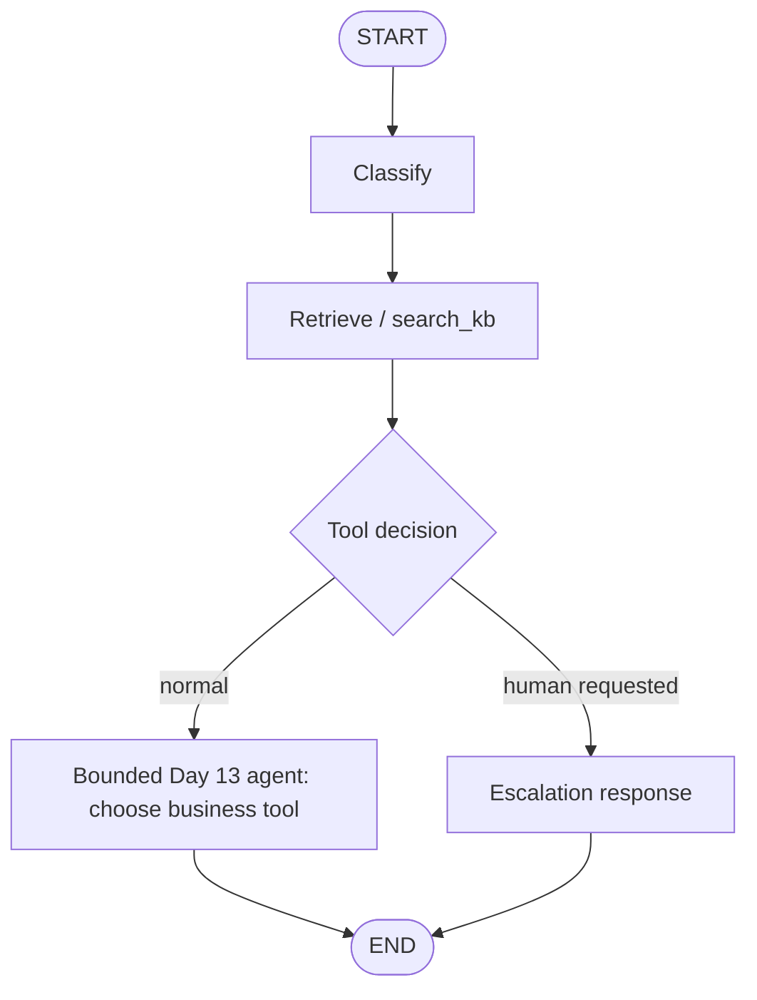

# Day 15 — Agentic RAG

## Goal
The agent chooses among `search_kb`, `get_order`, `get_customer`, and `create_ticket`.
LangGraph makes the outer workflow explicit; the Day 13 bounded model/tool loop
selects a business tool inside the answer node.

## Security invariant
The model can draft a ticket, never confirm it. `SupportToolbox.execute`
rejects invented `confirm_ticket` calls. Human-only `SupportToolbox.confirm`
is not exposed in model tool schemas or graph nodes. A pending draft gets an
application-owned status message instead of trusting the model's claim.

## Failure behavior
- KB retrieval errors and timeouts become an error result, not a graph crash.
- Model failures, empty answers and step-budget exhaustion become safe fallbacks.
- A human escalation returns a handoff message but does not contact a human.
- Tool execution inside the original Day 13 agent is **not** individually timed;
  `agent_timeout_s` limits how long the graph waits, but Python threads cannot be
  forcibly killed. The underlying call may continue. This is **not** a robust
  execution budget or write-side-effect cancellation. Day 20 must address it.
- The existing order/customer demo tools are not fully tenant-isolated. Day 22
  must enforce tenant isolation at every data boundary.
- The Day 15 benchmark uses a **scripted model** to test routing and safety;
  it does not establish real Ollama model accuracy, citation quality, or RAG
  answer correctness. Run the live model and record misses separately.

## Acceptance evidence
- `python3 -m pytest -q` (all existing tests + new tests)
- `python3 -m scripts.day15_demo` (normal/escalation + zero tickets)
- `python3 -m evals.day15_run` (20 deterministic route cases; target >=16)
- `artifacts/day15.json` and `artifacts/day15-benchmark.json`

## Day 16 forward compatibility
No persistence is added. Day 16 introduces `thread_id` and PostgreSQL-backed
checkpoints; do not mistake today's in-memory toolbox for durable memory.
