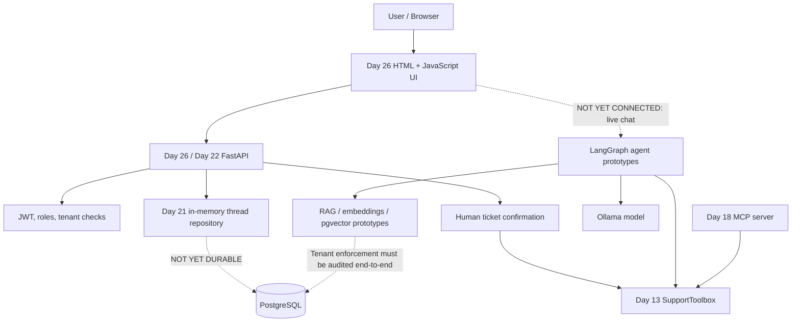

# SupportPilot architecture — implemented modules and integration gaps

**Solid arrows:** existing direct paths or module-level relationships. **Dashed arrows:** missing integration or security work. The diagram is a conceptual overview, not a verified production deployment topology.

## Request boundary
The browser's bearer token is validated by API authentication. User/tenant identity must come from verified claims, never from client-supplied request bodies. Tool read access should check ownership at the data source; ticket confirmation must be human-only.

## Key engineering choices
- FastAPI for typed, inspectable HTTP APIs.
- Ollama for local model experimentation.
- pgvector for relational, tenant-filtered vector search experiments.
- LangGraph for explicit stateful agent orchestration.
- MCP to explore portable business-tool interfaces.
- Plain JavaScript frontend to avoid an extra build system during the sprint.

See `docs/day27-threat-model.md` and `docs/day28-readiness.md` for known gaps.
